# Aether

Aether is a Python SDK for persistent, character-driven simulations. You define a world, place characters and objects in it, and change that world only by submitting **actions**. Accepted actions become **events**: durable facts the simulation stores, and that each witness can remember and believe.

The library is aimed at interactive fiction, mystery games, NPC sandboxes, and any host app that needs a rules engine underneath language-model dialogue. Models can propose what a character *tries*. Modules decide what actually happens. Cognition turns committed events into subjective memory and knowledge.

Version `0.1.0` is an early runtime. Inventory, navigation, dialogue mechanics, cognitive encoding, Postgres persistence, and an act-one LangGraph `interact` loop are in place.

## What you get

- **Worlds** made of locations, characters, items, and sessions.
- **Characters** with identity, personality, emotion, goals, beliefs, episodic memory, relationships, inventory, and capabilities.
- **A module system** that registers action schemas, event schemas, handlers, and perception handlers.
- **An action/event split.** An action is an attempt. An event is a committed fact. Rejected attempts do not change the world.
- **CognitiveEngine** that, after accepted events, builds per-witness perceptions and writes memory + knowledge.
- **A store abstraction.** `InMemoryStore` by default; `PostgresStore` (Neon-friendly) behind `Aether.postgres()`.
- **A place to attach a chat model** (`AetherAI`) without letting the model mutate world state directly.

## How a turn works

```mermaid
flowchart LR
    Caller["Host app"] --> Step["Aether.step"]
    Step --> Action["Action"]
    Action --> Engine["RuntimeEngine"]
    Engine --> Validate["Validate parameters"]
    Validate --> Handler["Module handler"]
    Handler --> Events["WorldEvents"]
    Events --> Check["Validate event attributes"]
    Check --> Commit["Append events and bump version"]
    Commit --> Cognition["CognitiveEngine"]
    Cognition --> Perceive["Perceive per witness"]
    Perceive --> Mind["Memory + knowledge"]
    Mind --> Store["Persist world and events"]
```



1. The host builds an `Action`: who is acting, what they are trying (`WorldAction.type`), and typed parameters.
2. Prefer `aether.step(world, action)` (not bare `world.step`) so cognition and persistence run.
3. `RuntimeEngine` validates the action, runs the module handler, validates returned events, appends them, and bumps the world version.
4. `CognitiveEngine` runs for each witness: module perception handler → episodic/working memory → belief (when importance is high enough).
5. Accepted events and the world snapshot (including updated minds) are saved through the store.

Failures raise `AetherError` subclasses inside the engine. `World.step` catches those and returns `SimulationResult(accepted=False, reason=...)`. The world version does not move, and `Aether.step` does not write anything.

## Architecture

| Layer | Role | Owns data? |
| --- | --- | --- |
| Domain models (`World`, `Character`, `Action`, `WorldEvent`, …) | Pydantic data | Yes |
| `RuntimeEngine` | Rules / modules / commit events | No |
| `CognitiveEngine` | Perceive → remember → learn | No (writes onto characters) |
| `Store` / repositories | Persistence ports | Adapters |
| `AetherAI` / LangGraph | NL act-one loop + dialogue text | No |

Rule of thumb: engines and registries are plain Python services. Things that serialize or travel over an API stay as Pydantic models.

## Requirements

- Python 3.11+
- [uv](https://docs.astral.sh/uv/) (the project uses `uv_build` and `uv.lock`)

Runtime dependencies include Pydantic, LangChain/LangGraph for the AI layer, and `psycopg` for Postgres. The in-memory path does not need a database or an API key.

## Install

From a checkout of this repository:

```bash
uv sync
```

To use Aether from another project on the same machine:

```bash
uv pip install -e .
```

Copy `.env.example` to `.env` only if you want Postgres or an OpenAI chat model. Neither is required to run the one-room demo.

## Quick start

`examples/one_room_demo.py` builds a single room, two characters, and one item, then has the player pick the item up.

```python
from aether import Action, Aether, WorldAction
from aether.modules import InventoryModule

aether = Aether().use(InventoryModule())

world = aether.create_world(
    name="Blackwood Manor",
    description="A mystery mansion full of secrets.",
)

library = world.create_location(
    name="Library",
    description="A quiet room filled with old books.",
)

player = world.create_character(
    name="Detective",
    role="Player",
    location_id=library.id,
)

arthur = world.create_character(
    name="Arthur",
    role="Butler",
    background="Arthur has served the family for thirty years.",
    location_id=library.id,
)

arthur.add_goal("Protect the family reputation.", priority=90)
arthur.learn(
    "No one saw Arthur enter the study.",
    believed_value="true",
    confidence=0.8,
)
arthur.remember(
    "Arthur entered the study at midnight and found the victim already dead.",
    importance=0.95,
    emotion="fear",
)

old_key = world.create_item(
    name="Old Key",
    description="A brass key with strange initials engraved on it.",
    location_id=library.id,
)

action = Action(
    actor_id=player.id,
    target_id=old_key.id,
    data=WorldAction(
        type="pick_up_item",
        module="inventory",
        parameters={"item_id": old_key.id},
    ),
)

result = aether.step(world, action)

print(result.accepted)          # True
print(result.events[0].type)    # item_picked_up
print(player.inventory.item_ids)
print([m.perspective for m in player.memory.episodic])
# ["I picked up the Old Key."]
print([m.perspective for m in arthur.memory.episodic])
# includes "I saw Detective pick up the Old Key."
print(aether.list_actions())
```

Run it with:

```bash
uv run python examples/one_room_demo.py
```

For the Phase 1 host path (navigation + dialogue + NL act-one loop):

```bash
uv run python examples/manor_interact_demo.py
```

With `OPENAI_API_KEY` set, `aether.interact(...)` decides one action at a time, steps the world, and turns speaking events into dialogue lines. Without a key, typed actions still run; NL decide returns immediately and dialogue stubs from topic.

```python
from aether import Aether
from aether.ai.model import llm
from aether.modules import DialogueModule, InventoryModule, NavigationModule

aether = Aether(model=llm).use(
    InventoryModule(),
    NavigationModule(),
    DialogueModule(),
)
world = aether.create_world(name="Blackwood Manor")
# ... author locations, characters, items, connect_locations ...
session = world.create_session()
result = aether.interact(world, session, "ask Arthur about the key", actor_id=player.id)
```

`Aether()` uses `InMemoryStore`. `create_world` saves the world immediately. `aether.step` encodes cognition and saves again only when the action is accepted.

If the detective is not in the library, or someone already holds the key, `result.accepted` is `False` and `result.reason` explains the rule that failed.

## Concepts

### World

`World` is the aggregate root. It owns:

| Field | Role |
| --- | --- |
| `metadata` | Name and description. |
| `state.version` | Monotonic counter. Increases once per accepted action. |
| `locations` | Places, keyed by id. |
| `characters` | People, keyed by id. |
| `items` | Objects, keyed by id. |
| `sessions` | Play sessions attached to this world. |
| `events` | In-memory append-only log of committed `WorldEvent`s. |
| `engine` | The `RuntimeEngine` that executes actions. Not persisted. |

Authoring methods on `World`:

- `create_location(name, description="")`
- `connect_locations(from_location_id, to_location_id, bidirectional=True)`
- `create_character(name, role="", background="", location_id=None)`
- `create_item(name, description="", location_id=None, owner_id=None)`
- `create_session(external_player_id=None)`
- `step(action) -> SimulationResult` — simulation only; prefer `aether.step`
- `describe_character` / `describe_item` / `describe_location`
- `determine_witnesses(actor_id) -> list[str]`

An item is either in a location or owned by a character, never both. `determine_witnesses` returns every character whose `location_id` matches the actor, including the actor.

### Characters

| Piece | What it stores | How you use it |
| --- | --- | --- |
| `identity` | Name, role, background. | Set at creation. |
| `state` | Emotion, status, `location_id`. | Updated by modules / cognition. |
| `personality` | Traits, values, fears, speaking style. | Data for future dialogue. |
| `memory` | Working, episodic, semantic memory. | Written by `CognitiveEngine` after events; also `remember` / `recall`. |
| `knowledge` | Beliefs (may be false). | Written by cognition when importance is high; also `learn`. |
| `goals` | Active / completed / failed goals. | `add_goal`. |
| `relationships` | Directed trust, affinity, fear, suspicion. | `update_relationship`. |
| `inventory` | Item ids, optional capacity. | Prefer inventory actions over editing by hand. |
| `capabilities` | Named allowed attempts. | Not enforced by the engine yet. |
| `planner` | Strategy name (`goal_driven`). | Placeholder. |

`Memory` and `Knowledge` live on the character (data). `CognitiveEngine` operates on them; it does not own them.

### Cognition

After accepted events, `Aether.step` calls `CognitiveEngine.encode_events`:

1. For each id in `event.witnessed_by`, run the module perception handler (or a generic fallback).
2. Write an episodic `MemoryRecord` and a working-memory item from the `Perception`.
3. If perception importance ≥ `0.4`, form or reinforce a `Belief` from the perception summary (`Knowledge.learn` upserts by proposition).

Inventory perception examples:

| Witness role | Perspective |
| --- | --- |
| Actor who picked up | “I picked up the Old Key.” |
| Bystander | “I saw Detective pick up the Old Key.” |

Calling `world.step(action)` alone skips cognition and store writes. Use `aether.step(world, action)`.

### Actions and events

```python
Action(
    actor_id=player.id,
    target_id=old_key.id,
    data=WorldAction(
        type="pick_up_item",
        module="inventory",
        parameters={"item_id": old_key.id},
    ),
)
```

`WorldEvent` is the record that survives: envelope fields (`id`, `world_id`, `actor_id`, `witnessed_by`, …) plus payload `data` (`type`, `module`, `attributes`).

Query the in-memory log with `world.events.latest()`, `by_type()`, `by_actor()`, and `by_witness()`.

### Modules

`AetherModule` subclasses implement `register(registry)`. Registration installs actions, events, and perception handlers.

```python
aether = Aether().use(InventoryModule())
```

Modules are installed on that SDK instance’s engine. Call `use` again before `load_world` after a restart.

| Module | Status | Actions |
| --- | --- | --- |
| `InventoryModule` | Implemented | `pick_up_item`, `drop_item`, `give_item`, `use_item` |
| `NavigationModule` | Implemented | `move` |
| `DialogueModule` | Implemented | `speak`, `say_to`, `ask_question` |

#### Inventory rules (summary)

- **pick_up_item** — actor and unowned item must share a location; ownership moves to the actor.
- **drop_item** — actor must own the item; item returns to the actor’s location.
- **give_item** — recipient is `action.target_id`; same location required.
- **use_item** — actor must own the item; current handler consumes it (placed at actor location). No per-item effect table yet.

#### Navigation rules (summary)

- **move** — destination must exist and be in `connected_location_ids` of the actor’s current location; updates `character.state.location_id`; emits `character_moved`.

#### Dialogue rules (summary)

- **speak** / **say_to** / **ask_question** — commit speaking events with a topic gist (not polished NL). Target must share the actor’s location when addressed.
- Events: `dialogue_spoken`, `question_asked`. Surface lines come from `generate_dialogue` inside `aether.interact` after those events succeed.

List registered mechanics:

```python
aether.list_actions()
aether.engine.modules.list_events()
aether.engine.modules.list_perceptions()
```

#### Writing a module

```python
from pydantic import BaseModel, Field

from aether.domain.actions import Action
from aether.domain.events import WorldActionEvent, WorldEvent
from aether.domain.world import World
from aether.engine.registries import ModuleRegistry
from aether.modules.base import AetherModule


class SpeakParams(BaseModel):
    text: str = Field(..., description="Line the actor says.")


class SpeechAttributes(BaseModel):
    text: str
    speaker_id: str


class SpeechModule(AetherModule):
    name = "speech"
    version = "0.1.0"

    def register(self, registry: ModuleRegistry) -> None:
        registry.actions.register(
            action_type="speak",
            module_name=self.name,
            parameter_model=SpeakParams,
            handler=self.speak,
        )
        registry.events.register(
            event_type="speech_spoken",
            module_name=self.name,
            attribute_model=SpeechAttributes,
        )
        # optional: registry.perceptions.register(...)

    def speak(self, world: World, action: Action) -> list[WorldEvent]:
        params = SpeakParams.model_validate(action.data.parameters)
        return [
            WorldEvent(
                world_id=world.id,
                actor_id=action.actor_id,
                data=WorldActionEvent(
                    type="speech_spoken",
                    module=self.name,
                    attributes={
                        "text": params.text,
                        "speaker_id": action.actor_id,
                    },
                ),
                witnessed_by=world.determine_witnesses(action.actor_id),
            )
        ]
```

### Sessions and timelines

`world.create_session()` starts a `Session` on the `main` branch with timeline, interaction history, and runtime context. `session.interact(message)` is still a placeholder: it records a turn but does not interpret language or call `step`.

### Persistence

`Aether` takes a single `Store` (not individual repositories):

```python
aether = Aether()                              # InMemoryStore
aether = Aether.memory()                       # explicit in-memory
aether = Aether.postgres(apply_migrations=True)  # Neon / Postgres
```

`PostgresStore` reads `DATABASE_URL` (see `.env.example`). `apply_migrations=True` runs `src/aether/repositories/schema.sql`.

| Table | Contents |
| --- | --- |
| `worlds` | Id, name, JSON world document (engine excluded). |
| `characters` | Per-world character JSON. |
| `sessions` | Session JSON. |
| `events` | Append-only event rows. Duplicate ids raise `DuplicateError`. |

Host apps should go through `Aether` / `Store`. Repository classes remain available for custom stores.

### AI layer

`AetherAI` holds the engine plus optional LangChain `BaseChatModel` and `Embeddings`.

```python
from aether.ai.model import llm
from aether import Aether

aether = Aether(model=llm)
```

| Variable | Default | Meaning |
| --- | --- | --- |
| `OPENAI_MODEL` | `gpt-4o` | Chat model name. |
| `OPENAI_MAX_RETRIES` | `8` | Retries for transient rate limits. |
| `OPENAI_API_KEY` | — | Required for live OpenAI calls. |

`aether.interact` runs an act-one LangGraph loop:

```text
gather_context → decide_next_action (one action or respond)
  → validate_action → aether.step → generate_dialogue (narrative + optional spoken lines)
  → loop until respond or max_steps
```

Presentation is module-agnostic: after committed events, `generate_dialogue` returns third-person `narrative` and, when speaking events occurred, `dialogue` lines.

Prefer `Aether.interact` over deprecated `Session.interact`.

## SDK surface

```python
aether = Aether()                       # or .memory() / .postgres()
aether.use(InventoryModule())           # chains; returns self
aether.create_world(name, description="")
aether.get_world(world_id)
aether.load_world(world_id)
aether.save(world)
aether.delete_world(world_id)
aether.step(world, action)              # execute → cognize → persist if accepted
aether.interact(world, session, message, actor_id=...)  # NL act-one loop
aether.list_actions()
```

Public package exports: `Aether`, `AetherModule`, `Action`, `WorldAction`, `WorldActionEvent`, `WorldEvent`, `World`, `Character`, `Location`, `Item`.

## Errors

| Exception | When |
| --- | --- |
| `AetherError` | Base type. `World.step` catches this and rejects the action. |
| `AetherValidationError` | Bad input or broken domain rule. |
| `UnknownActionError` | Action type not registered. |
| `UnknownEventError` | Event type not registered. |
| `ModuleNotFoundError` | Module never installed. |
| `NotFoundError` | Repository miss. |
| `DuplicateError` | Event id already exists. |
| `RepositoryError` | Store failures (e.g. missing `DATABASE_URL`). |

## Layout

```text
src/aether/
  aether.py                 SDK entry: store, engine, cognition, AI, step
  domain/                   World, Character, Action, Event, Session, …
  engine/                   RuntimeEngine, registries
  modules/                  inventory, navigation, dialogue
  cognition/                CognitiveEngine, perception, memory, knowledge
  components/               Goals, inventory, timeline, planner, shared
  repositories/             Store, InMemory*, Postgres*, schema.sql
  ai/                       act-one LangGraph interact loop, prompts, model factory
examples/
  one_room_demo.py
  manor_interact_demo.py
```

## Status

Implemented:

- World authoring, action validation, inventory/navigation/dialogue handlers, event log, versioning.
- Character memory, beliefs, goals, relationships, inventory.
- `CognitiveEngine` hooked into `Aether.step` (perceive → memory → knowledge).
- In-memory and Postgres persistence via `Store`.
- Perception handlers (actor vs witness perspectives) for inventory, navigation, dialogue.
- `Aether.interact` act-one loop: decide → step → narrative (+ dialogue when speaking).

Not implemented yet:

- Reactive NPC planner beat (`npc_react`).
- Detective module (`examine` / `search` / `present_evidence`).
- Enforcement of `capabilities`.
- Item-specific effects for `use_item`.
- Narrative / cinematic generation modes.
- Console script entry (`aether:main` is not defined). Run the example instead.

## License

No license file is included in this repository yet.
