# Aether

Aether is a Python SDK for persistent, character-driven simulations. You define a world, place characters and objects in it, and change that world only by submitting **actions**. Accepted actions become **events**: durable facts the simulation stores, and that each witness can remember and believe.

Models can propose what a character *tries*. Modules decide what actually happens. Cognition turns committed events into subjective memory and knowledge.

**Version `0.1.0`** — early runtime. Inventory, navigation, dialogue, access, containers, time, cognitive encoding, Postgres persistence, and an act-one LangGraph `interact` loop are in place.

## Contents

1. [Quickstart](#quickstart)
2. [Architecture](#architecture)
3. [Creating a world](#creating-a-world)
4. [Creating characters](#creating-characters)
5. [Actions & events](#actions--events)
6. [Building modules](#building-modules)
7. [Cognition](#cognition)
8. [AI runtime](#ai-runtime)
9. [Persistence](#persistence)
10. [LangGraph lifecycle](#langgraph-lifecycle)
11. [Custom module tutorial](#custom-module-tutorial)
12. [Blackwood Manor example](#blackwood-manor-example)
13. [OOC example](#ooc-example)

---

## Quickstart

**Requirements:** Python 3.11+. [uv](https://docs.astral.sh/uv/) recommended for local development.

```bash
pip install aether-sim                 # core simulation SDK
pip install "aether-sim[ai]"           # + LangGraph interact / OpenAI helpers
pip install "aether-sim[postgres]"     # + Neon/Postgres store
pip install "aether-sim[all]"          # ai + postgres
```

From a git checkout:

```bash
uv sync --all-extras
```

Core runtime needs Pydantic only. Optional extras add LangChain/LangGraph (`[ai]`) and `psycopg` (`[postgres]`). The in-memory path does not need a database or an API key. Copy `.env.example` to `.env` only if you want Postgres or an OpenAI chat model.

Minimal typed turn (`examples/one_room_demo.py`):

```python
from aether import Action, Aether, WorldAction
from aether.modules import InventoryModule

aether = Aether().use(InventoryModule())

world = aether.create_world(
    name="Blackwood Manor",
    description="A mystery mansion full of secrets.",
)

library = world.create_location(
    name="Library",
    description="A quiet room filled with old books.",
)

player = world.create_character(
    name="Detective",
    role="Player",
    location_id=library.id,
)

arthur = world.create_character(
    name="Arthur",
    role="Butler",
    background="Arthur has served the family for thirty years.",
    location_id=library.id,
)

arthur.add_goal("Protect the family reputation.", priority=90)
arthur.learn(
    "No one saw Arthur enter the study.",
    believed_value="true",
    confidence=0.8,
)
arthur.remember(
    "Arthur entered the study at midnight and found the victim already dead.",
    importance=0.95,
    emotion="fear",
)

old_key = world.create_item(
    name="Old Key",
    description="A brass key with strange initials engraved on it.",
    location_id=library.id,
)

action = Action(
    actor_id=player.id,
    target_id=old_key.id,
    data=WorldAction(
        type="pick_up_item",
        module="inventory",
        parameters={"item_id": old_key.id},
    ),
)

result = aether.step(world, action)

print(result.accepted)          # True
print(result.events[0].type)    # item_picked_up
print(player.inventory.item_ids)
print([m.perspective for m in player.memory.episodic])
# ["I picked up the Old Key."]
print([m.perspective for m in arthur.memory.episodic])
# includes "I saw Detective pick up the Old Key."
```

```bash
uv run python examples/one_room_demo.py
```

Natural-language turns need a chat model and `aether.interact`:

```bash
uv run python examples/manor_interact_demo.py
```

```python
from aether import Aether
from aether.ai.model import llm
from aether.modules import DialogueModule, InventoryModule, NavigationModule

aether = Aether(model=llm).use(
    InventoryModule(),
    NavigationModule(),
    DialogueModule(),
)
# ... author world, create session ...
result = aether.interact(world, session, "ask Arthur about the key", actor_id=player.id)
```

`Aether()` uses `InMemoryStore`. `create_world` saves immediately. `aether.step` encodes cognition and saves again only when the action is accepted. Prefer `aether.step(world, action)` over bare `world.step` so cognition and persistence run.

---

## Architecture

| Layer | Role | Owns data? |
| --- | --- | --- |
| Domain models (`World`, `Character`, `Action`, `WorldEvent`, …) | Pydantic data | Yes |
| `RuntimeEngine` | Rules / modules / commit events | No |
| `CognitiveEngine` | Perceive → remember → learn | No (writes onto characters) |
| `Store` / repositories | Persistence ports | Adapters |
| `AetherAI` / LangGraph | NL act-one loop + dialogue text | No |

Rule of thumb: engines and registries are plain Python services. Things that serialize or travel over an API stay as Pydantic models.

How a turn works:



```mermaid
flowchart LR
    Caller["Host app"] --> Step["Aether.step"]
    Step --> Action["Action"]
    Action --> Engine["RuntimeEngine"]
    Engine --> Validate["Validate parameters"]
    Validate --> Handler["Module handler"]
    Handler --> Events["WorldEvents"]
    Events --> Check["Validate event attributes"]
    Check --> Commit["Append events and bump version"]
    Commit --> Cognition["CognitiveEngine"]
    Cognition --> Perceive["Perceive per witness"]
    Perceive --> Mind["Memory + knowledge"]
    Mind --> Store["Persist world and events"]
```

1. The host builds an `Action`: who is acting, what they are trying (`WorldAction.type`), and typed parameters.
2. Prefer `aether.step(world, action)` so cognition and persistence run.
3. `RuntimeEngine` validates the action, runs the module handler, validates returned events, appends them, and bumps the world version.
4. `CognitiveEngine` runs for each witness: module perception handler → episodic/working memory → belief (when importance is high enough).
5. Accepted events and the world snapshot (including updated minds) are saved through the store.

Failures raise `AetherError` subclasses inside the engine. `World.step` catches those and returns `SimulationResult(accepted=False, reason=...)`. The world version does not move, and `Aether.step` does not write anything.

### Layout

```text
src/aether/
  aether.py                 SDK entry: store, engine, cognition, AI, step
  domain/                   World, Character, Action, Event, Session, …
  engine/                   RuntimeEngine, registries
  modules/                  inventory, navigation, dialogue, access, …
  content/                  scenario JSON/YAML loader
  cognition/                CognitiveEngine, perception, memory, knowledge
  components/               Goals, inventory, timeline, planner, capabilities
  repositories/             Store, InMemory*, Postgres*, schema.sql
  ai/                       act-one LangGraph interact loop, prompts, model
examples/
  one_room_demo.py
  manor_interact_demo.py
  ooc_session_demo.py
  scenarios/blackwood_manor.json
  scenarios/gated_study.json
```

### SDK surface

```python
aether = Aether()                       # or .memory() / .postgres()
aether.use(InventoryModule())           # chains; returns self
aether.create_world(name, description="")
aether.get_world(world_id)
aether.load_world(world_id)
aether.save(world)
aether.delete_world(world_id)
aether.step(world, action)              # execute → cognize → persist if accepted
aether.interact(world, session, message, actor_id=..., style=..., idempotency_key=..., callbacks=...)
aether.interact_stream(...)             # yields event, narrative_delta, dialogue_line, result
aether.undo(world, session)             # restore previous turn snapshot
aether.fork(world, session)             # branch + restore snapshot
aether.checkout(world, session, "main")
aether.list_actions()
```

Public exports: `Aether`, `AetherModule`, `Action`, `WorldAction`, `WorldActionEvent`, `WorldEvent`, `World`, `Character`, `Location`, `Item`.

### Errors

| Exception | When |
| --- | --- |
| `AetherError` | Base type. `World.step` catches this and rejects the action. |
| `AetherValidationError` | Bad input or broken domain rule. |
| `UnknownActionError` | Action type not registered. |
| `UnknownEventError` | Event type not registered. |
| `ModuleNotFoundError` | Module never installed. |
| `NotFoundError` | Repository miss. |
| `DuplicateError` | Event id already exists. |
| `RepositoryError` | Store failures (e.g. missing `DATABASE_URL`). |

---

## Creating a world

`World` is the aggregate root. It owns:

| Field | Role |
| --- | --- |
| `metadata` | Name and description. |
| `state.version` | Monotonic counter. Increases once per accepted action. |
| `locations` | Places, keyed by id. |
| `characters` | People, keyed by id. |
| `items` | Objects, keyed by id. |
| `sessions` | Play sessions attached to this world. |
| `events` | In-memory append-only log of committed `WorldEvent`s. |
| `engine` | The `RuntimeEngine` that executes actions. Not persisted. |

Authoring methods:

- `create_location(name, description="")`
- `connect_locations(from_location_id, to_location_id, bidirectional=True)`
- `create_character(name, role="", background="", location_id=None)`
- `create_item(name, description="", location_id=None, owner_id=None)`
- `create_session(external_player_id=None)`
- `step(action) -> SimulationResult` — simulation only; prefer `aether.step`
- `describe_character` / `describe_item` / `describe_location`
- `determine_witnesses(actor_id) -> list[str]`

An item is either in a location or owned by a character, never both. `determine_witnesses` returns every character whose `location_id` matches the actor, including the actor.

Or load a scenario file:

```python
from aether.content import load_scenario

world = load_scenario(aether, "examples/scenarios/blackwood_manor.json")
session = world.create_session()
```

### Sessions and timelines

`world.create_session()` starts a `Session` on the `main` branch with timeline, interaction history, runtime context, and an initial world tip snapshot.

```python
branch = aether.fork(world, session)                 # fork current tip
branch = aether.fork(world, session, from_turn_id=t)  # fork a prior turn
aether.checkout(world, session, "main")              # restore another branch
aether.undo(world, session)                          # restore previous turn snapshot
```

Each completed `Aether.interact` turn stores a world snapshot. `session.history_for_branch()` returns lineage-aware history up to the fork point.

---

## Creating characters

| Piece | What it stores | How you use it |
| --- | --- | --- |
| `identity` | Name, role, background. | Set at creation. |
| `state` | Emotion, status, `location_id`. | Updated by modules / cognition. |
| `personality` | Traits, values, fears, speaking style. | Data for dialogue prompts. |
| `memory` | Working, episodic, semantic memory. | Written by `CognitiveEngine` after events; also `remember` / `recall`. |
| `knowledge` | Beliefs (may be false). | Written by cognition when importance is high; also `learn`. |
| `goals` | Active / completed / failed goals. | `add_goal`. |
| `relationships` | Directed trust, affinity, fear, suspicion. | `update_relationship`. |
| `inventory` | Item ids, optional capacity, `equipped` slot map. | Prefer inventory actions over editing by hand. |
| `capabilities` | Named allowed attempts. | Empty = unrestricted; otherwise enforced by `RuntimeEngine`. |
| `planner` | Strategy name (`goal_driven`). | Placeholder. |

`Memory` and `Knowledge` live on the character (data). `CognitiveEngine` operates on them; it does not own them.

### Capabilities

Characters start with an empty capability set, which means **unrestricted** (any registered action may be attempted).

If you add one or more capabilities, the character may only perform actions whose `required_capability` is in that set. By default each registered action requires a capability matching its action type (`pick_up_item`, `move`, `ask_question`, …).

```python
player.add_capability("move")
player.add_capability("pick_up_item")
# player.can("ask_question") -> False; RuntimeEngine will reject ask_question
```

Pinned facts stay in later prompts:

```python
character.pin_fact("Her name is Mara.", key="name", kind="name")
session.pin_fact("It is raining.", key="weather", kind="scene")
```

---

## Actions & events

An **action** is an attempt. An **event** is a committed fact. Rejected attempts do not change the world.

```python
Action(
    actor_id=player.id,
    target_id=old_key.id,
    data=WorldAction(
        type="pick_up_item",
        module="inventory",
        parameters={"item_id": old_key.id},
    ),
)
```

`WorldEvent` is the record that survives: envelope fields (`id`, `world_id`, `actor_id`, `witnessed_by`, …) plus payload `data` (`type`, `module`, `attributes`).

Query the in-memory log with `world.events.latest()`, `by_type()`, `by_actor()`, and `by_witness()`.

If the detective is not in the library, or someone already holds the key, `result.accepted` is `False` and `result.reason` explains the rule that failed.

---

## Building modules

`AetherModule` subclasses implement `register(registry)`. Registration installs actions, events, and perception handlers.

```python
aether = Aether().use(InventoryModule())
```

Modules are installed on that SDK instance’s engine. Call `use` again before `load_world` after a restart.

| Module | Actions / role |
| --- | --- |
| `InventoryModule` | `pick_up_item`, `drop_item`, `give_item`, `use_item`, `equip_item`, `unequip_item` |
| `NavigationModule` | `move` (blocked by locked/closed passages) |
| `DialogueModule` | `speak`, `say_to`, `ask_question`, `answer_question`, `whisper`, `refuse`; `truthfulness` flag |
| `SocialModule` | Relationship deltas after social events (no extra verbs) |
| `AccessModule` | `lock`, `unlock`, `open`, `close` (keys from inventory) |
| `ContainerModule` | `open_container`, `close_container`, `put_in`, `take_from` |
| `TimeModule` | `wait`, plus agenda moves when the clock enters a schedule |
| `DetectiveModule` | `examine`, `search_location`, `present_evidence` |

List registered mechanics:

```python
aether.list_actions()
aether.engine.modules.list_events()
aether.engine.modules.list_perceptions()
```

### Inventory

- **pick_up_item** — actor and unowned item must share a location; ownership moves to the actor.
- **drop_item** — actor must own the item; item returns to the actor’s location. Equipped items must be unequipped first.
- **give_item** — recipient is `action.target_id`; same location required. Equipped items must be unequipped first.
- **use_item** — actor must own the item; modes include `keep` / `consume` / `transform`. Equipped items must be unequipped first.
- **equip_item** / **unequip_item** — named slots; item stays owned.

### Navigation

- **move** — destination must exist and be in `connected_location_ids`; updates `character.state.location_id`; emits `character_moved`.

### Dialogue

- **speak** / **say_to** / **ask_question** / **answer_question** — commit speaking events with a topic gist (not polished NL). Targets must share the actor’s location when addressed.
- **ask_question** — `target_character_ids` for one or more people; empty list asks the crowd.
- **answer_question** — reply to a `questioner_id`, or omit it to answer the room.
- Events: `dialogue_spoken`, `question_asked`, `question_answered`. Surface lines come from `generate_dialogue` inside `aether.interact` after those events succeed.

### Detective

- **examine** — inspect an item in reach/inventory or the current location; emits `examined`.
- **search_location** — reveal `hidden` items in the actor’s location; emits `location_searched`.
- **present_evidence** — show an owned item to a colocated character without transferring it; emits `evidence_presented`.

Items may set `hidden=True` and optional `tags` at creation.

For a full walkthrough of writing your own module, see [Custom module tutorial](#custom-module-tutorial).

---

## Cognition

After accepted events, `Aether.step` calls `CognitiveEngine.encode_events`:

1. For each id in `event.witnessed_by`, run the module perception handler (or a generic fallback).
2. Write an episodic `MemoryRecord` and a working-memory item from the `Perception`.
3. If perception importance ≥ `0.4`, form or reinforce a `Belief` from the perception summary (`Knowledge.learn` upserts by proposition).

Inventory perception examples:

| Witness role | Perspective |
| --- | --- |
| Actor who picked up | “I picked up the Old Key.” |
| Bystander | “I saw Detective pick up the Old Key.” |

Calling `world.step(action)` alone skips cognition and store writes. Use `aether.step(world, action)`.

Episodic lines in AI prompts stay capped; `memory.consolidate()` (also run automatically once a character has four new episodes) folds older episodes into semantic lore.

---

## AI runtime

`AetherAI` holds the engine plus optional LangChain `BaseChatModel` and `Embeddings`.

```python
from aether.ai.model import llm
from aether import Aether

aether = Aether(model=llm)
```

| Variable | Default | Meaning |
| --- | --- | --- |
| `OPENAI_MODEL` | `gpt-4o` | Chat model name. |
| `OPENAI_MAX_RETRIES` | `8` | Retries for transient rate limits. |
| `OPENAI_API_KEY` | — | Required for live OpenAI calls. |

Presentation after committed events is split into two renderers:

1. **Narrative** — immersive third-person prose (no quoted speech)
2. **Dialogue** — in-character spoken lines when speaking events occurred

Both use dedicated prompts grounded only in committed events and character briefs.

```python
from aether import PresentationCallbacks, PresentationStyle

def on_delta(text: str) -> None:
    print(text, end="", flush=True)

result = aether.interact(
    world,
    session,
    "ask Mara about tonight, quietly",
    actor_id=player.id,
    style=PresentationStyle(tone="lyrical", length="terse", pov="third"),
    idempotency_key="turn-12",
    callbacks=PresentationCallbacks(on_narrative_delta=on_delta),
)
# Same key returns the stored result and does not apply the beat again.
aether.interact(world, session, "ask Mara about tonight, quietly", idempotency_key="turn-12")
```

`interact_stream` yields the same beats as they commit: `event`, then `narrative_delta` / `dialogue_line`, then a final `result` chunk. Narrative tokens are not emitted before the step commits.

### Turn report

`InteractionResult.report` (`TurnReport`) summarizes a host turn: decisions, reject reasons, event types, speaking events, dialogue count, NPC actions, cognition counts, the rolling `scene_summary`, `relationship_deltas`, and `open_questions`.

```python
result = aether.interact(world, session, "pick up the key", actor_id=player.id)
print(result.report.event_types)
print(result.report.beliefs_formed)
print(result.report.scene_summary.text if result.report and result.report.scene_summary else "")
print([q.topic for q in (result.report.open_questions if result.report else [])])
print(result.trace.reject_reasons)
```

Host-facing continuity:

- `session.scene_summary` is refreshed after each interact and copied onto `result.report.scene_summary`.
- `result.report.relationship_deltas` lists trust / affinity / fear / suspicion changes from this turn.
- `result.report.open_questions` lists `question_asked` events that no later answer or refusal closed.

Prefer `Aether.interact` over deprecated `Session.interact`.

---

## Persistence

`Aether` takes a single `Store` (not individual repositories):

```python
aether = Aether()                              # InMemoryStore
aether = Aether.memory()                       # explicit in-memory
aether = Aether.postgres(apply_migrations=True)  # Neon / Postgres
```

`PostgresStore` reads `DATABASE_URL` (see `.env.example`). `apply_migrations=True` runs `src/aether/repositories/schema.sql`.

| Table | Contents |
| --- | --- |
| `worlds` | Id, name, JSON world document (engine excluded). |
| `characters` | Per-world character JSON. |
| `sessions` | Session JSON. |
| `events` | Append-only event rows. Duplicate ids raise `DuplicateError`. |

Host apps should go through `Aether` / `Store`. Repository classes remain available for custom stores.

---

## LangGraph lifecycle

`aether.interact` runs an act-one LangGraph loop (`src/aether/ai/graph.py`):

```text
gather_context
  → decide_next_action          # one action or respond
  → validate_action             # reject → decide again
  → execute_action              # aether.step
  → generate_dialogue           # narrative + optional spoken lines
  → npc_react                   # optional one NPC beat
  → loop until respond or max_steps
```

| Node | Responsibility |
| --- | --- |
| `gather_context` | Scene, actor, witnesses, open questions, pinned facts, recent history. |
| `decide_next_action` | Model chooses one registered action or ends the turn (`respond`). |
| `validate_action` | Schema / capability checks before commit; failed attempts loop back to decide. |
| `execute_action` | Calls `aether.step`; cognition and store write on accept. |
| `generate_dialogue` | Renders narrative (and dialogue lines when speaking events committed). |
| `npc_react` | Optional single NPC follow-up action, then back into execute or decide. |

Conditional edges (`src/aether/ai/edges.py`) route after decide, validate, execute, presentation, and NPC react. The graph ends when the model chooses to respond or the step budget is exhausted.

Typed `aether.step` still works with no model. `aether.interact(...)` requires `Aether(model=llm)`.

---

## Custom module tutorial

Minimal speech module:

```python
from pydantic import BaseModel, Field

from aether.domain.actions import Action
from aether.domain.events import WorldActionEvent, WorldEvent
from aether.domain.world import World
from aether.engine.registries import ModuleRegistry
from aether.modules.base import AetherModule


class SpeakParams(BaseModel):
    text: str = Field(..., description="Line the actor says.")


class SpeechAttributes(BaseModel):
    text: str
    speaker_id: str


class SpeechModule(AetherModule):
    name = "speech"
    version = "0.1.0"

    def register(self, registry: ModuleRegistry) -> None:
        registry.actions.register(
            action_type="speak",
            module_name=self.name,
            parameter_model=SpeakParams,
            handler=self.speak,
        )
        registry.events.register(
            event_type="speech_spoken",
            module_name=self.name,
            attribute_model=SpeechAttributes,
        )
        # optional: registry.perceptions.register(...)

    def speak(self, world: World, action: Action) -> list[WorldEvent]:
        params = SpeakParams.model_validate(action.data.parameters)
        return [
            WorldEvent(
                world_id=world.id,
                actor_id=action.actor_id,
                data=WorldActionEvent(
                    type="speech_spoken",
                    module=self.name,
                    attributes={
                        "text": params.text,
                        "speaker_id": action.actor_id,
                    },
                ),
                witnessed_by=world.determine_witnesses(action.actor_id),
            )
        ]
```

Install it like any built-in module:

```python
aether = Aether().use(SpeechModule())
```

Handlers return events; they do not mutate the world directly beyond what those events imply. Perception handlers (optional) turn committed events into first-person `Perception`s for cognition.

---

## Blackwood Manor example

Scenario pack under `examples/scenarios/blackwood_manor.json`: library, hall, study, detective, butler, and a key.

```python
from aether import Aether
from aether.ai.model import llm
from aether.content import load_scenario
from aether.modules import (
    DetectiveModule,
    DialogueModule,
    InventoryModule,
    NavigationModule,
)

aether = Aether(model=llm).use(
    InventoryModule(),
    NavigationModule(),
    DialogueModule(),
    DetectiveModule(),
)

world = load_scenario(aether, "examples/scenarios/blackwood_manor.json")
session = world.create_session()
player = next(c for c in world.characters.values() if c.identity.name == "Detective")

result = aether.interact(
    world,
    session,
    "examine the key, then ask Arthur about it",
    actor_id=player.id,
)
print(result.narrative)
print(result.dialogue)
```

Interactive demo:

```bash
uv run python examples/manor_interact_demo.py
```

A locked room and a hidden clue without custom Python: `examples/scenarios/gated_study.json` (hall, key, locked passage, letter in a closed chest).

---

## OOC example

Aether stays the world model. The host renders `narrative`, `dialogue`, and `report` and does not keep a second copy of inventory, location, or secrets.

What not to reinvent in the host: memory, beliefs, relationships, scene continuity, or “who heard that.” Read them back from the character and from `TurnReport`.

```python
from aether import Aether, PresentationCallbacks, PresentationStyle
from aether.ai.model import llm
from aether.modules import (
    AccessModule,
    ContainerModule,
    DialogueModule,
    InventoryModule,
    NavigationModule,
    SocialModule,
    TimeModule,
)

aether = Aether(model=llm).use(
    InventoryModule(),
    NavigationModule(),
    DialogueModule(),
    SocialModule(),
    AccessModule(),
    ContainerModule(),
    TimeModule(),
)
```

Long social walkthrough (typed beats, no live model required):

```bash
uv run python examples/ooc_session_demo.py
```

That script plays 10+ beats — whisper privacy, a lie, a refusal, a pin, a key, a container, a schedule, undo, and an idempotent retry — and checks world consistency.

### Building a host app

1. Create an SDK instance and install the modules you need.
2. Author a world (code or scenario file), create a session, then call `aether.interact` for NL turns and/or `aether.step` for typed actions.
3. Choose a store: default `Aether()` / `Aether.memory()` for local/dev; `Aether.postgres(apply_migrations=True)` for Neon/Postgres.
4. Render `result.narrative`, `result.dialogue`, and optionally `result.report` in your UI.

---

## Status

Implemented:

- World authoring, action validation, inventory / navigation / dialogue / access / containers / time / detective handlers, event log, versioning.
- Character memory, beliefs, goals, relationships, inventory, capabilities enforcement.
- `CognitiveEngine` hooked into `Aether.step` (perceive → memory → knowledge).
- In-memory and Postgres persistence via `Store`.
- `Aether.interact` act-one loop: decide → step → narrative/dialogue → optional `npc_react`.
- Host turn report (`InteractionResult.report`) and scenario packing (`aether.content.load_scenario`).

Not implemented yet:

- Rich per-item effect tables beyond `use_item` modes.
- Narrative / cinematic generation modes as separate host modes.
- A first-party CLI. Use the examples under `examples/` for now.

## License

MIT. See [LICENSE](LICENSE).
